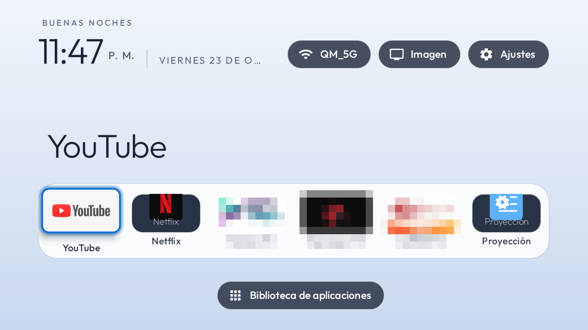
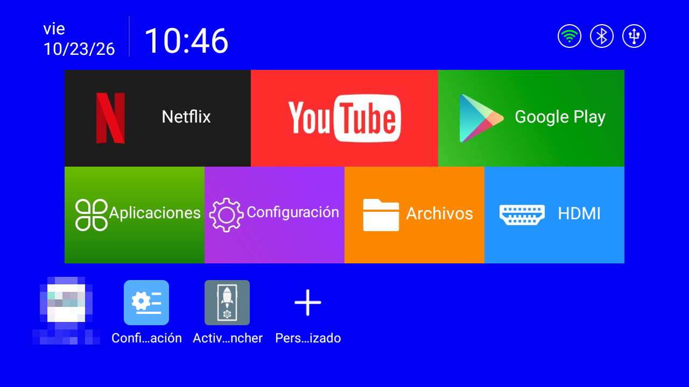
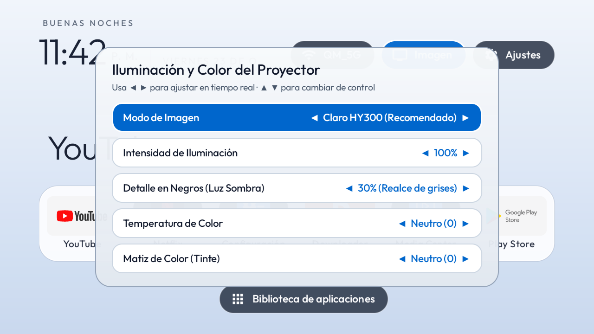
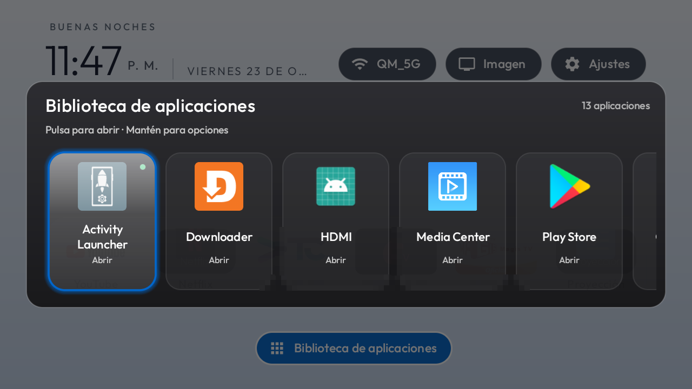

# HY300 Projector Optimization — Debloat, Apple TV Light Mode Launcher & Real-Time Display Calibration

<p align="center">
  
</p>

## Credits & Inspiration

This project is heavily inspired by and adapted from **[CleanYourTV (`Gathin23/cleanyourtv`)](https://github.com/Gathin23/cleanyourtv)** by [Gathin](https://github.com/Gathin23).

While **CleanYourTV** was designed with a pitch-black OLED/LED TV theme, budget LCD smart projectors like the **Magcubic / Allwinner / Rockchip HY300 (`rk3326_sgo`)** suffer from low ANSI lumen output, severe dark-level shadow compression, hidden Android Developer Options, and an unstable SDIO Wi-Fi TCP buffer that drops standard ADB transfers.

We adapted and re-engineered the workflow and native launcher specifically for the **HY300 Projector**:
- **Apple TV Light Mode UI**: High-contrast pearl-white and silver-blue aesthetic (`#F1F5FB` → `#DCE7F5` → `#C7D7ED`) with a frosted white glass dock (`#E6FFFFFF`) and **Apple Blue** (`#0066CC`) focus ring designed to maximize perceived brightness and legibility on a projected wall or screen.
- **Real-Time Global Display & Color Calibration (`Imagen`)**: Built-in hardware-accelerated screen filter (`DisplayFilter.java` + `HomeKeyService.java`) featuring **Black Detail / Shadow Lift** (to recover crushed dark scenes on the HY300), **Illumination Intensity**, **Color Temperature**, **Tint**, and 5 projector-tuned presets.
- **Single-Row 6-App Dock + Centered App Library**: Ultra-clean home screen featuring your 6 main apps (including direct hardware **Projection / Keystone** access) and a single centered button below the dock to open the full **App Library**.
- **HY300 SDIO Wi-Fi Paced TCP Transfer (`tools/tv.py` & `deploy.sh`)**: Solves the notorious Rockchip `rk3326_sgo` Wi-Fi bug where ADB connections reset on payloads larger than 24–40 KB.

---

## Before & After Showcase

| Stock HY300 Launcher (Before) | Apple TV Light Mode for HY300 (After) |
| :---: | :---: |
|  |  |
| *Cluttered dark interface, background bloatware, and crushed dark contrast* | *High-contrast Apple TV Light Mode, 6-app frosted glass dock, zero bloatware* |

| Real-Time Projector Display & Color Controls | Full App Library Modal |
| :---: | :---: |
|  |  |
| *Adjust Shadow Lift (Black Detail), Illumination, Color Temp & Tint across all apps* | *One-click access to File Manager, Play Store, Downloader & utilities below the dock* |

---

## Hardware Specifications Tested

- **Model / Board**: HY300 Smart Projector (`rk3326_sgo`, Rockchip RK3326, `armeabi-v7a`, 2 GB RAM)
- **OS / API Level**: Android 12L (SDK 32)
- **Native Resolution**: `1280x720` @ `160 dpi`

---

## Step-by-Step Guide to Reproduce This Exact Result

### Step 0: Enable USB Debugging & ADB Internet via Activity Launcher

Unlike standard Android TVs, the HY300 stock firmware hides the Android **Developer Options** menu inside its simplified projector settings. You must unlock it using **Activity Launcher**:

1. **Install Activity Launcher on your HY300**:
   - Copy [`ActivityLauncher.apk`](ActivityLauncher.apk) (included in this repository) to a USB flash drive, plug it into the HY300, open the stock **Media Center / Files** app, and install it (or install Activity Launcher from the built-in app store / browser).
2. **Locate `Configuration` → `Developer Configuration`**:
   - Open **Activity Launcher** on the projector.
   - Wait for the list of installed system packages to load and scroll down to **`Configuration`** (`com.android.tv.set`).
   - Click **`Configuration`** to expand its internal activities, then find and click **`Developer Configuration`** (*Developer Options*).
3. **Enable USB Debugging & ADB Internet**:
   - Inside **Developer Configuration**, turn **ON** both toggles:
     1. **USB debugging** (*Depuración USB*)
     2. **ADB Internet** (*Network ADB debugging* — opens TCP port `5555`)
4. **Find your Projector's IP Address**:
   - Go to the projector's Wi-Fi settings and note its local IP address (e.g., `192.168.0.174`). Keep the projector turned on and connected to the same Wi-Fi network as your computer.

---

### Option A: Automated 1-Command Deployment (Fastest)

If you already have `adb` and `python3` installed on your computer, you can deploy our prebuilt [`TvHome-HY300.apk`](TvHome-HY300.apk), apply the 6-app dock [`config.json`](config.json), and set up the launcher in one step:

```bash
# 1. Clone this repository
git clone https://github.com/lquero95/hy300-projector-cleantv.git
cd hy300-projector-cleantv

# 2. Deploy the launcher and configuration (replace with your projector's IP)
TV_HOST=192.168.0.174 sh deploy.sh
```

> **Note:** When you run `deploy.sh` for the first time, look at your projector screen and click **"Allow"** on the *"Allow USB debugging?"* prompt.

To safely disable the HY300 stock bloatware and enable AdGuard Private DNS over ADB:

```bash
export TV_HOST=192.168.0.174
adb connect $TV_HOST:5555

# Disable HY300 bloatware & factory test packages (reversible, nothing is uninstalled)
for pkg in \
  com.shzhtxcz.txbox \
  com.sszztxr.oott \
  com.shzhtxcz.txcz.test \
  com.rockchip.devicetest \
  com.aispeech.tvui \
  com.rockchip.itvbox \
  com.sszztxr.app \
  com.tv.client.droid.nexocine \
  com.shzhtxcz.txbox.launcher; do
  adb -s $TV_HOST:5555 shell "pm disable-user --user 0 $pkg"
done

# Optional: Enable system-wide ad-blocking Private DNS
adb -s $TV_HOST:5555 shell "settings put global private_dns_specifier dns.adguard-dns.com"
adb -s $TV_HOST:5555 shell "settings put global private_dns_mode hostname"
```

---

### Option B: Reproduce with an AI Coding Assistant (`PROMPT.md`)

Want your AI coding assistant (**Claude Code**, **Gemini CLI**, **Google Antigravity**, **Codex**, or **Cursor**) to inspect your projector, back up your packages, customize your dock apps, build the launcher from source, and verify every screen automatically?

1. Complete **Step 0** above (enable **USB debugging** and **ADB Internet** under **Configuration → Developer Configuration** in Activity Launcher).
2. Clone this repo so your assistant has access to `launcher/` and `tools/tv.py`.
3. Copy the prompt from **[`PROMPT.md`](PROMPT.md)** into your AI assistant and replace `<YOUR_PROJECTOR_IP_HERE>` with your HY300's IP address.

---

## Key Features Engineered for the HY300

### 1. Apple TV Light Mode (High-Contrast Projector UI)
- **Luminous Gradient Background**: Uses a pearl-white to soft silver-blue gradient (`#F1F5FB` → `#DCE7F5` → `#C7D7ED` in [`bg_apple_light.xml`](launcher/app/src/main/res/drawable/bg_apple_light.xml)) so the projector operates in its peak contrast zone without washing out dark room environments.
- **Frosted White Glass Dock & Apple Blue Focus Ring**: Rendered via [`DockDecoration.java`](launcher/app/src/main/java/com/gathin/tvhome/DockDecoration.java) and [`GlassView.java`](launcher/app/src/main/java/com/gathin/tvhome/GlassView.java) with crisp dark-slate (`#0F172A`) typography.

### 2. Real-Time Global Display & Color Calibration (`Imagen`)
Accessible from the **`Imagen`** pill button in the top-right bar ([`DisplayFilter.java`](launcher/app/src/main/java/com/gathin/tvhome/DisplayFilter.java) + global accessibility overlay in [`HomeKeyService.java`](launcher/app/src/main/java/com/gathin/tvhome/HomeKeyService.java)):
- **Picture Mode Presets**:
  - *Claro HY300 (Recomendado)* — Boosts shadow detail (`+25%`) and slightly cools yellow LED cast (`+10`)
  - *Cine Cálido* — Warm cinema tone with lifted blacks (`+20%`)
  - *Vívido Frío* — Crisp daylight tone
  - *Noche Suave* — Dimmed (`75%`), warm eye-care mode for dark bedrooms
  - *Estándar (Neutro)* — Zero filter bypass
- **Illumination Intensity**: `20%` to `100%` (adjustable in 5% steps with D-pad `◀ ▶`).
- **Black Detail / Shadow Lift (`Detalle en Negros`)**: `0%` to `100%` — lifts dark gray tones out of projector black crush so dark movies remain clear.
- **Color Temperature & Tint**: Fine-tune `Warm (-50) ↔ Cool (+50)` and `Green (-50) ↔ Magenta (+50)` in real time.

### 3. Single-Row 6-App Dock + Hardware Projection Shortcut
- Displays only your **6 favorite apps** on the home screen (customizable in [`config.json`](config.json)).
- Includes **`com.android.tv.settings`** renamed to **Proyección** (*Projection*) right on the dock so you never lose access to the HY300's hardware **Keystone correction, Auto/Manual Focus, and Zoom settings**.
- Pressing **Down** on the remote highlights the centered **App Library** (`Biblioteca de aplicaciones`) button, opening all other installed apps in a clean modal dialog while keeping `Activity Launcher` hidden from daily view.

### 4. Paced TCP ADB Transfer (`tools/tv.py`)
The Rockchip `rk3326_sgo` SDIO Wi-Fi driver resets TCP sockets when bursting >24–40 KB. [`tools/tv.py`](tools/tv.py) works around this by streaming screenshots in 3 KB chunks over `nc` and verifying both the PNG header and `IEND` trailer before saving.

---

## Rebuilding the APK from Source

If you modify the Java/XML source code inside [`launcher/`](launcher/):

```bash
cd launcher
./gradlew assembleDebug
cp app/build/outputs/apk/debug/app-debug.apk ../TvHome-HY300.apk
```

---

## 1-Line Full Restore to Factory State

Nothing is ever uninstalled from the system partition. If you ever want to re-enable every stock package and return to the original HY300 launcher, simply run:

```bash
TV_HOST=192.168.0.174 sh restore.sh
```

To revert Private DNS back to default:

```bash
adb -s 192.168.0.174:5555 shell "settings put global private_dns_mode opportunistic"
```

---

## Repository Structure

| File / Folder | Description |
|---|---|
| [`PROMPT.md`](PROMPT.md) | Complete English prompt for AI coding assistants to reproduce this setup from scratch |
| [`TvHome-HY300.apk`](TvHome-HY300.apk) | Prebuilt & signed Apple TV Light Mode Launcher APK with Display Calibration |
| [`ActivityLauncher.apk`](ActivityLauncher.apk) | Activity Launcher APK used in Step 0 to unlock `Configuration → Developer Configuration` |
| [`config.json`](config.json) | 6-app single-row dock configuration, custom labels, and hidden utility list |
| [`deploy.sh`](deploy.sh) | Automated paced-TCP installer and configuration deployment script |
| [`restore.sh`](restore.sh) | One-command restore script that re-enables all stock packages and the original launcher |
| [`tools/tv.py`](tools/tv.py) | Paced-TCP screenshot & remote key injection utility immune to HY300 Wi-Fi drops |
| [`tools/verify_ui.py`](tools/verify_ui.py) | Automated config pusher & screenshot verification script |
| [`launcher/`](launcher/) | Complete Android Studio / Gradle source code for the customized HY300 launcher |
| [`backup/`](backup/) | Reference snapshot of HY300 system properties (`getprop.txt`) and package lists |
| [`shots/`](shots/) | Before & after verification screenshots captured directly from the HY300 |

---

## License

MIT License — see [`LICENSE`](LICENSE).
Original CleanYourTV launcher architecture and documentation Copyright (c) 2026 [Gathin](https://github.com/Gathin23/cleanyourtv). HY300 Projector adaptations, Apple TV Light Mode theme, and Global Display Calibration Filter contributed for the HY300 community.
